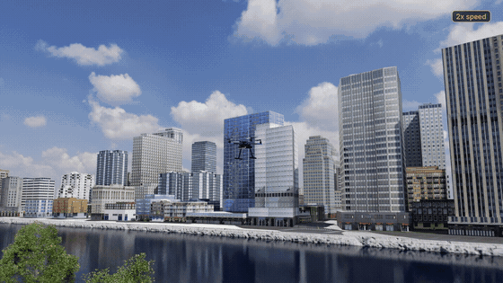
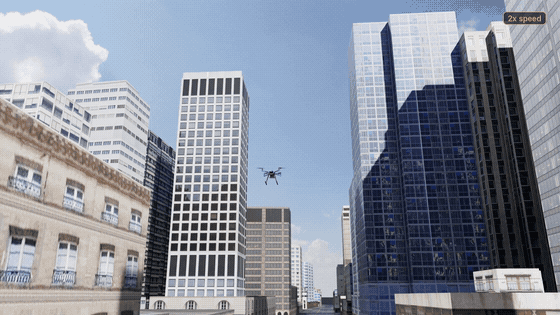
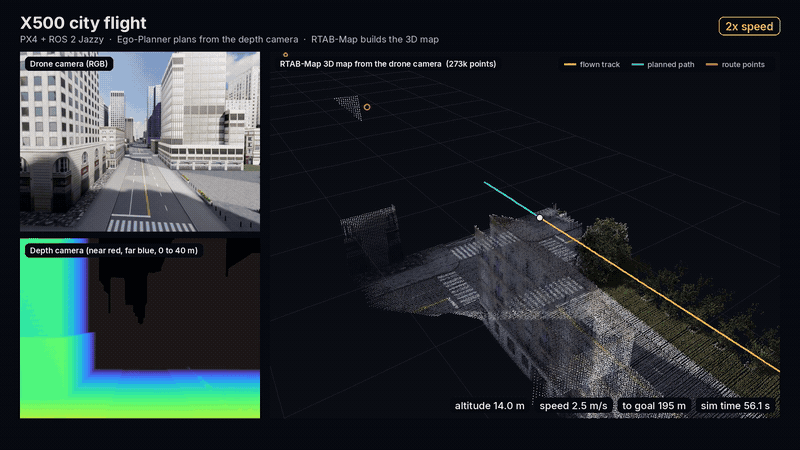

# x500-city-nav

A Holybro X500 quadrotor flies itself from point A to point B through a city in NVIDIA Isaac Sim 6.1. PX4 flies the
drone, Ego-Planner avoids buildings using the depth camera, and RTAB-Map builds a 3D map of the street. Everything
talks over ROS 2 Jazzy.

<p align="center">
  
  
</p>
<p align="center">
  
</p>

## Getting started

Tested on Ubuntu 22.04 with an RTX 5070 Ti (16 GB). You need Isaac Sim 6.1 (pip install in a uv environment; set
`ISAAC_PY` if it is not `~/IsaacLab3/.venv/bin/python`) and Docker with the NVIDIA Container Toolkit.

1. Clone the repository and the patched Pegasus Simulator (the PX4 bridge for Isaac Sim):
   ```bash
   git clone https://github.com/prakash-aryan/x500-city-nav.git ~/x500-city-nav
   git clone https://github.com/PegasusSimulator/PegasusSimulator.git ~/PegasusSimulator_isaac61
   cd ~/PegasusSimulator_isaac61 && git checkout bef3c57 && git apply ~/x500-city-nav/patches/pegasus_isaac61.patch
   cd ~/x500-city-nav
   ```
2. Build the drone model. `--step` is optional: the Holybro X500 V2 CAD file from the
   [Holybro download page](https://docs.holybro.com/drone-development-kit/px4-development-kit-x500v2/download);
   without it the frame comes from the PX4 meshes.
   ```bash
   git clone --depth 1 https://github.com/PX4/PX4-gazebo-models.git ~/PX4-gazebo-models
   uv run --with "usd-core==25.5.*" --with numpy --with trimesh --with pycollada --with cascadio \
     python scripts/build_x500_usd.py --px4 ~/PX4-gazebo-models --step ~/Downloads/x500v2-frame.step
   ```
3. Build the container with PX4, RTAB-Map and Ego-Planner (about 30 minutes):
   ```bash
   docker build -t x500-city-nav:latest docker/
   ```
4. Download the NVIDIA Omniverse "AEC City Tower Demo Pack" (not included) and point to it. `SKY_HDR` is any
   lat-long sky image, for example from Poly Haven:
   ```bash
   export CITY_USD=/path/to/CityTowerDemopack/World_CityTowerDemopack.usd SKY_HDR=/path/to/sky.hdr
   ```
5. Start the simulator (terminal 1) and wait for `Waiting for first hearbeat`:
   ```bash
   SPAWN_X=-25 SPAWN_Y=-32 SPAWN_Z=0.4 VIEWPORT_OFF=1 ./scripts/run_sim.sh
   ```
6. Start PX4 and the ROS 2 stack (terminal 2). The drone climbs to 14 m, flies 300 m up the street and lands:
   ```bash
   ROUTE="0,32,14;0,182,14;0,297,14" ALT=14 MAP_X=80 MAP_Y=620 MAP_Z=50 MAP_RES=0.4 ./scripts/run_autonomy.sh
   ```

`ROUTE` lists rough points `E,N,U` in metres from take-off; Ego-Planner finds the actual path. To record a flight,
add `RECORD=$PWD/runs/f1/pose.npy` to step 5 and `OUT_DIR=$PWD/runs/f1 RERUN=1` to step 6, then open it with
`rerun runs/f1/flight.rrd`.

## How it works

```
Isaac Sim 6.1   city + X500 with a forward RGB-D camera, Pegasus  <-- TCP 4560 -->  PX4 SITL
Container       px4_tf_pub.py    PX4 position estimate -> /px4_odom
                Ego-Planner      depth image + odometry -> collision-free trajectory
                RTAB-Map         RGB + depth + odometry -> 3D map
                mission_bridge   route points -> planner goals, trajectory -> PX4 offboard setpoints, landing
```

The planner has no prior map; it only sees the depth camera. Ego-Planner runs on simulation time
(`docker/patches/ego_planner_simtime.patch`) because the simulator runs slower than real time.

| Term | Meaning |
|---|---|
| PX4 SITL | The PX4 flight controller running on the PC instead of on the drone. |
| Offboard mode | PX4 mode in which an external program sends the setpoints. |
| Ego-Planner | Local planner that builds an occupancy grid from depth images and plans smooth paths around obstacles. |
| RTAB-Map | RGB-D mapping; builds the 3D point cloud of the street. |

## Troubleshooting

| Problem | Fix |
|---|---|
| The drone flies over an empty grid | `CITY_USD` is not set; the log says `[world] bare ground plane`. |
| `x500.usda not found` | Run step 2. |
| `ROS2 Bridge startup failed` | `ISAAC_PY` must point at the Isaac Sim 6.1 environment. |
| Bag without `metadata.yaml` | `ros2 bag reindex -s mcap runs/f1/bag` inside the container. |

Untested: building the container on a fresh machine and GPUs with less than 16 GB.

## Credits

PX4 Autopilot and the x500 model, Pegasus Simulator and RTAB-Map (BSD-3-Clause); Ego-Planner (GPL-3.0, only patches
are included here). The Holybro CAD, NVIDIA Isaac Sim, the RealSense model and the city pack are not redistributed.
